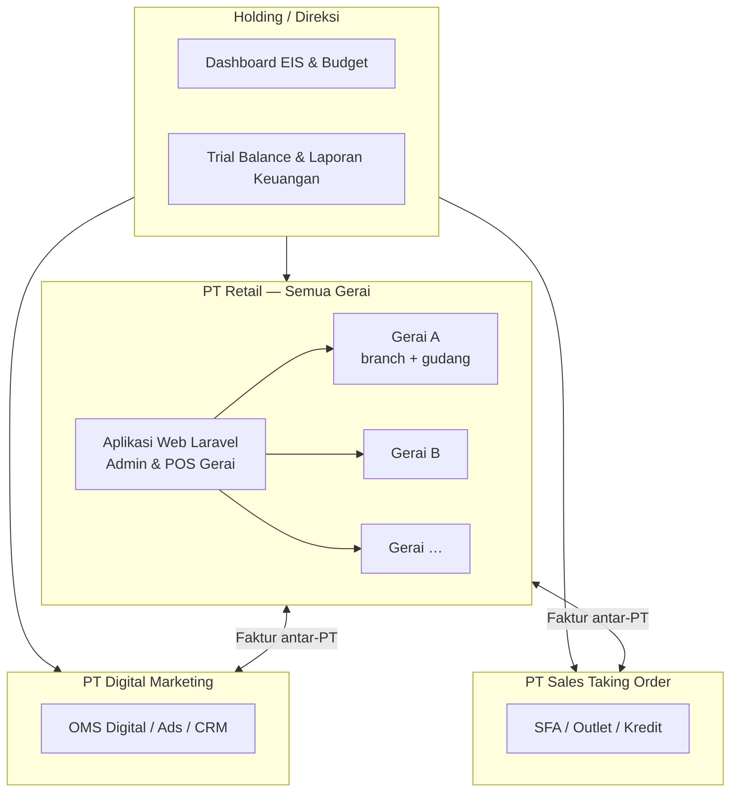
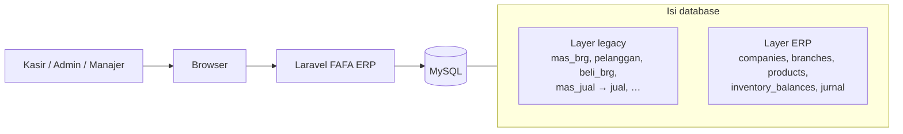
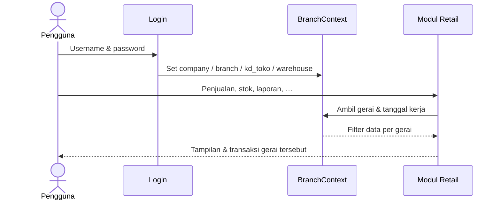
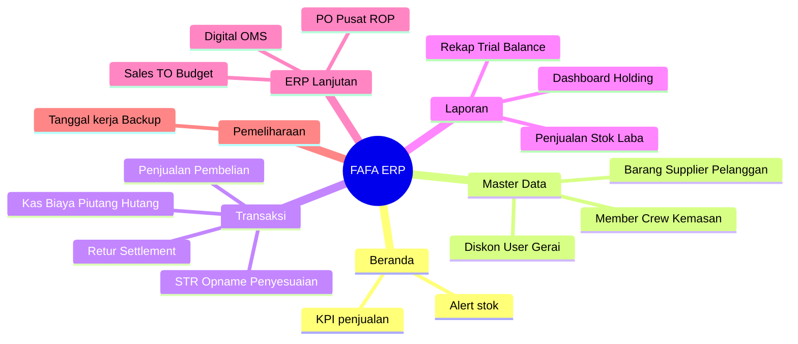
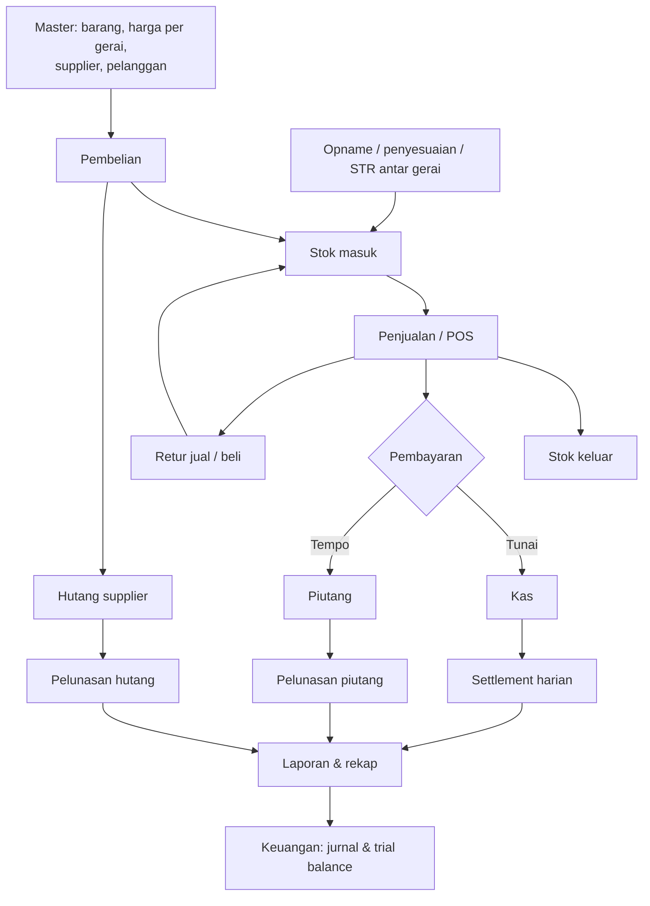
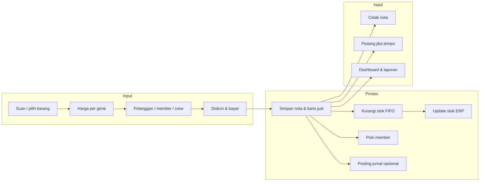
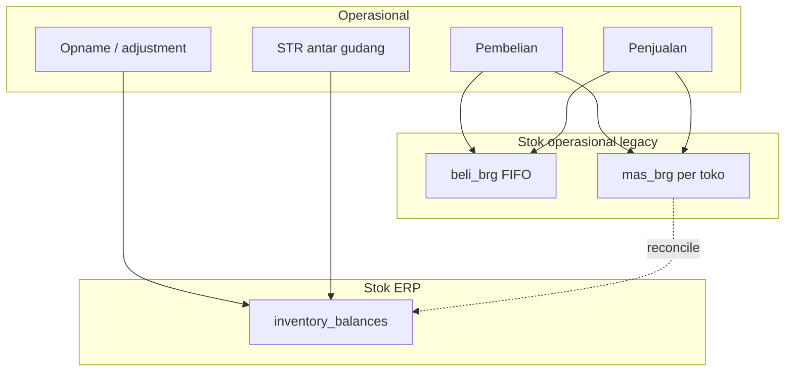
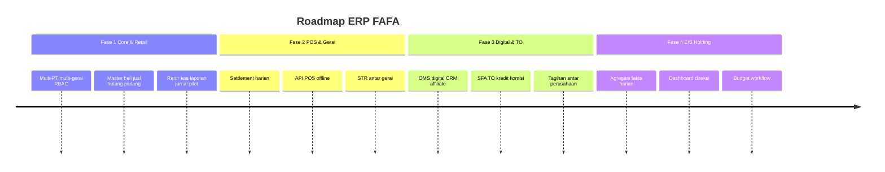

# Presentasi Sistem ERP FAFA — Materi Client

Dokumen ini merangkum **alur, modul, dan roadmap** platform FAFA untuk presentasi ke stakeholder bisnis dan IT. Diagram menggunakan [Mermaid](https://mermaid.js.org); render di [mermaid.live](https://mermaid.live) lalu export PNG/SVG untuk PowerPoint atau Google Slides.

**Referensi teknis:** [ERP_ROADMAP.md](./ERP_ROADMAP.md) · [PHASE1_SCHEMA.md](./PHASE1_SCHEMA.md) · [FEATURE_MIGRATION_PLAN.md](../FEATURE_MIGRATION_PLAN.md)

---

## Executive summary (1 slide)

| Aspek | Penjelasan |
|--------|------------|
| **Apa ini?** | ERP retail multi-gerai dengan fondasi holding, migrasi bertahap dari admin PHP legacy ke Laravel |
| **Siapa pakai?** | Kasir, admin toko, manajer gerai, finance, direksi |
| **Data** | Satu database MySQL; historis tetap; modul baru memakai struktur ERP (`companies`, `branches`, jurnal, stok per gudang) |
| **Keunggulan** | SKU master + harga per gerai, stok per gudang, hutang/piutang, approval void, PO pusat, laporan terpusat |
| **Roadmap** | Fase 1 operasional retail + GL pilot → Fase 2 POS offline → Fase 3 Digital & TO → Fase 4 EIS holding |

---

## 1. Struktur grup usaha & peran sistem

Satu holding; **semua gerai** under **1 PT retail**; Digital Marketing dan Sales Taking Order sebagai PT terpisah (inter-company).



**Talking point:** Platform siap multi-PT; operasional harian fokus gerai retail; direksi melihat agregat holding (Fase 4).

---

## 2. Arsitektur aplikasi (high level)



**Talking point:** Migrasi **tanpa membuang** data lama; bridging data lewat command `erp:migrate-legacy-all` (lihat [MIGRATE_LEGACY_RUNBOOK.md](./MIGRATE_LEGACY_RUNBOOK.md)).

---

## 3. Login & konteks gerai

Setiap transaksi retail di-scope oleh **gerai aktif** (kode toko, gudang, tanggal kerja).



**Talking point:** Multi-gerai aman; hak akses (RBAC) membatasi void, diskon, ganti gerai.

---

## 4. Peta modul (menu aplikasi)



---

## 5. Siklus operasional harian gerai



**Talking point:** Mutasi antar gerai (satu PT) lewat **Transfer Stok (STR)**, selaras kebijakan ERP (bukan duplikasi modul mutasi lama).

---

## 6. Alur transaksi penjualan



**Talking point:** Void/hapus nota sensitif → **permintaan + approval** + audit log, bukan hapus langsung seperti sistem lama.

---

## 7. Stok — legacy & ERP (transisi)



**Talking point:** Fase transisi; target jangka panjang **satu kebenaran stok per gudang** di ERP.

---

## 8. Roadmap implementasi



Detail fase: [ERP_ROADMAP.md](./ERP_ROADMAP.md).

---

## 9. Urutan slide disarankan

| # | Slide | Audiens |
|---|--------|---------|
| 1 | Executive summary (tabel di atas) | Semua |
| 2 | Struktur grup usaha (§1) | Direksi / owner |
| 3 | Peta modul (§4) | Operasional |
| 4 | Siklus harian gerai (§5) | Manajer toko |
| 5 | Alur penjualan (§6) | Kasir / supervisor |
| 6 | Roadmap (§8) | Semua |
| 7 | Arsitektur & stok (§2, §7) | IT / vendor |

---

## 10. FAQ singkat untuk Q&A

**Apakah data lama hilang?**  
Tidak. Dump production tetap; Laravel menambah tabel ERP dan command migrasi mengisi `jual`, katalog ERP, dll.

**Berapa PT dalam satu login?**  
User terikat company/branch; holding bisa punya hak lihat lintas PT (Fase 4).

**POS offline?**  
Fase 2 — API sync; pilot gerai setelah Fase 1 stabil.

**Laporan keuangan?**  
Trial balance per company; posting dari transaksi terpilih (jual/beli/kas/biaya); historis GL lama tidak otomatis di-backfill.

---

## Lampiran — export diagram

1. Buka https://mermaid.live  
2. Paste blok ` ```mermaid ` dari dokumen ini  
3. **Actions → Export PNG/SVG**  
4. Sisipkan ke deck; gunakan font & warna brand client di slide master

---

*Terakhir diselaraskan dengan codebase Laravel FAFA (sidebar, routes, ERP_ROADMAP).*
